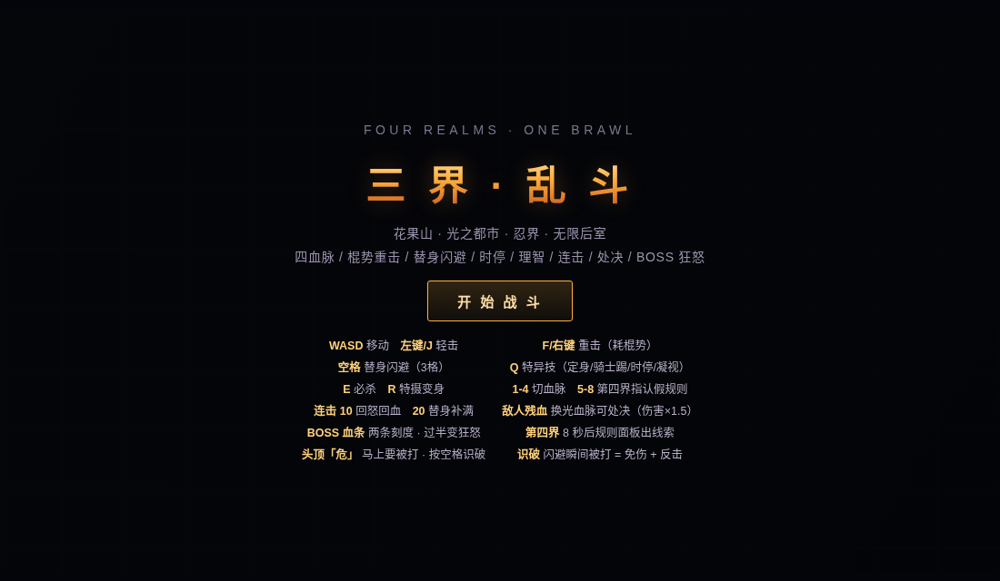
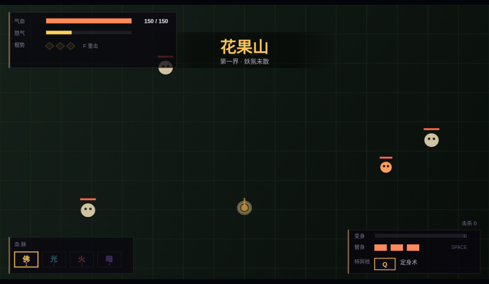
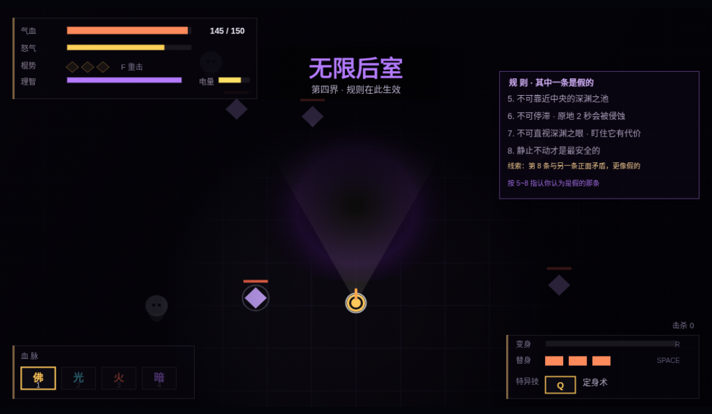
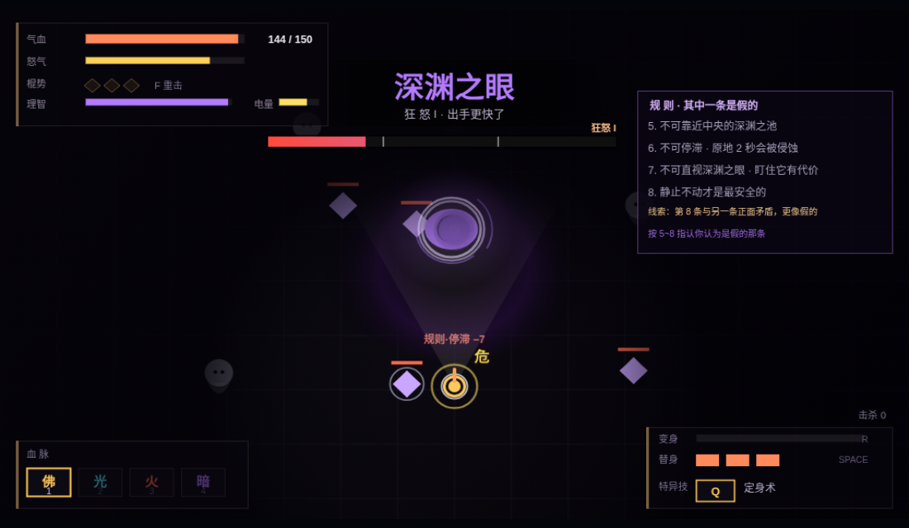

# 西游 · 特摄 · 月学 · 恐怖 大乱炖

一款**单文件网页游戏**：西游黑神话风 × 特摄英雄 × 热血日漫 × 恐怖规则怪谈，横版大乱斗 + 生存闯关肉鸽。

- **双击 `index.html` 即可开玩**，无需安装、无需联网、无 npm / TypeScript / 构建步骤。
- 纯原生 JavaScript + Canvas 2D，1024×600 画布等比缩放（缩到 760×430 小窗布局依然正确）。
- 在线试玩：https://abcqpwo.github.io/xiyou-tokusatsu-horror-brawl/

## 界面预览

| 主菜单 | 花果山战斗 |
| --- | --- |
|  |  |

| 无限后室 · 规则面板 | BOSS 战 |
| --- | --- |
|  |  |

## 玩法

四个世界，每界 2 波小怪 + 1 个 BOSS，界间三选一卡牌（18 张）：

| 世界 | BOSS | 主题 |
| --- | --- | --- |
| 花果山 | 白骨夫人 | 西游黑神话 · 棍势重击 |
| 光之都市 | 机械帝王 | 特摄英雄 · 骑士踢 / 变身 |
| 忍界 | 晓之领主 | 热血日漫 · 时停 / 替身 |
| 无限后室 | 深渊之眼 | 规则怪谈 · 理智 / 手电 / 假规则 |

## 操作

| 按键 | 作用 |
| --- | --- |
| WASD | 移动 |
| 鼠标左键 / J | 轻击 |
| F / 鼠标右键 | 重击（消耗棍势 0~3 段） |
| 空格 | 替身闪避（3 格，被打中瞬间闪避 = 识破，免伤 + 反击） |
| Q | 特异技（定身术 / 骑士踢 / 时停 / 凝视） |
| E | 必杀（消耗怒气） |
| R | 特摄变身（12 秒 + 8 秒冷却） |
| 1~4 | 切换血脉（佛 / 光 / 火 / 暗） |
| 5~8 | 第四界指认假规则 |
| P | 暂停 |

## 小机制

- **连击奖励**：10 连击回怒 + 回血；20 连击替身补满 + 震退敌人。
- **「危」预警**：敌方弹幕或贴身敌人要打到你时，身上出现黄环 +「危」字，此刻按空格可识破。
- **BOSS 狂怒**：血条两条刻度（66% / 33%），过半和濒死各进入一段狂怒，出手更快、招式更多。
- **残血处决**：敌人血量低于 25% 时，光血脉或变身状态下伤害 ×1.5。
- **第四界规则**：面板 4 条规则含 1 条假规则，8 秒后给线索，按 5~8 指认；指认对了加攻击，指认错了掉血。

## 文件

```
index.html                      # 游戏本体（v5 终版）
三界乱斗_v4备份.html             # 上一版备份
三界乱斗_v3备份.html
三界乱斗_v2备份.html
三界乱斗_v1备份.html
```

## 技术说明

- 单文件、零外部依赖，全部绘制与逻辑内联。
- 调试钩子保留：`window.__dbg = { S, startStage, spawnBoss, spawnHorde, nextStage, showCards, bossPattern, ACTS, CARDS, useSkill, heavyAttack, dealDamage, spawnEnemy, dieCheck }`。
- 数值、HUD、平衡常量集中在 `makePlayer / lightAttack / heavyAttack / useSkill / hurtPlayer / dieCheck / updateSanity / ACTS[].boss / CARDS`。

## 许可

个人练习作品，随意玩、随意改。
